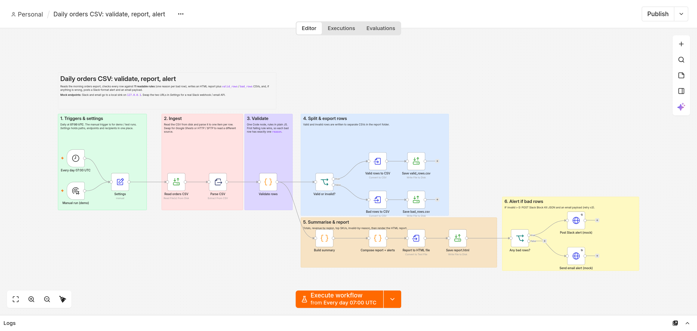
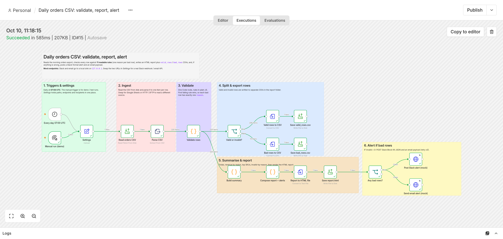
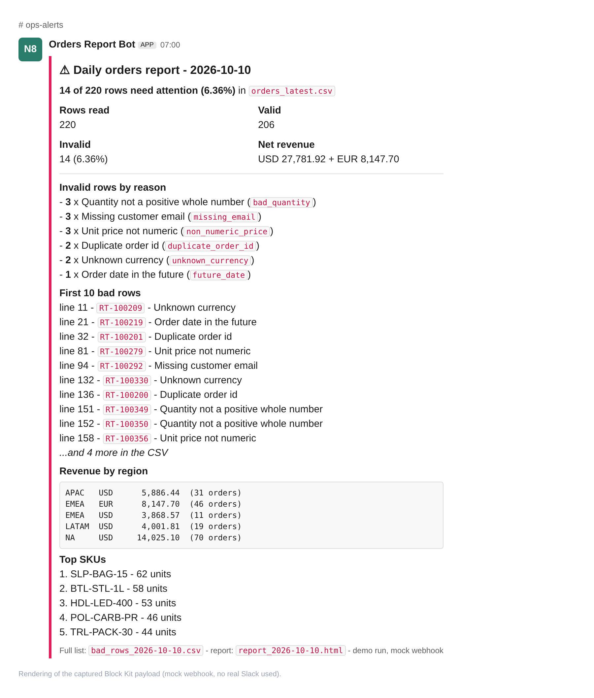

# Daily orders CSV: validate, report, alert (n8n)

## 60-second write-up

**Problem.** Every morning someone opens the sales/orders export, eyeballs it for broken rows (missing emails, negative
quantities, "N/A" prices, duplicate order ids...), builds a summary by hand and pings the team. It is slow, and bad rows
slip through into finance and fulfilment.

**What it does.** A schedule trigger (daily 07:00 UTC, plus a manual trigger for demos) reads the orders CSV, validates
every row against 11 plain-JavaScript rules (first failing rule wins, so each bad row gets exactly one reason), splits
good from bad, aggregates a summary (rows, valid, invalid, revenue by region, top SKUs, invalid-by-reason), writes an
HTML report plus `valid_rows` and `bad_rows` CSVs, and, only if there are bad rows, posts a Slack Block Kit message and
an email payload.

**Result (real run, execution #15, 585 ms).** 220 rows read, **206 valid, 14 invalid (6.36%)**. Net revenue (valid,
refunded excluded): USD 27,781.92 and EUR 8,147.70, split over 5 region/currency lines. Top SKU: `SLP-BAG-15`, 62 units.
Invalid by reason: 3 bad quantity, 3 missing email, 3 non-numeric price, 2 duplicate order id, 2 unknown currency,
1 future date. The numbers were cross-checked with an independent Python recount (14 invalid / 206 valid, same revenue).

| | |
|---|---|
|  |  |

Also: [rendered report](screenshots/03-report.png).

## How to run it

1. Put the sample file where n8n may read it (n8n 2.x restricts file nodes to `~/.n8n-files`):
   `~/.n8n-files/csv-daily-report-alert/input/orders_latest.csv` (copy from `sample-data/`), and create the
   `reports/` folder next to `input/`.
2. Start the mock Slack/email sink: `python3 tools/mock_sink.py 5690 output/mock-sink-received.jsonl`
3. Import: `n8n import:workflow --input=workflow.json` (the workflow id is `csvDailyReport01`).
4. Run: open the workflow and click **Execute workflow** on *Manual run (demo)*, or
   `secret run ... -- python3 tools/run_via_rest.py` (REST call, credentials from the environment only).
   Activate the workflow to let the 07:00 UTC schedule fire.
5. Optional: `python3 tools/render_slack_card.py output/mock-sink-received.jsonl output/` re-renders the Slack-style card;
   `node tools/screenshots.mjs ...` takes the screenshots (needs `puppeteer-core` and Chrome).

To regenerate the sample data: `python3 tools/generate_orders.py sample-data/orders_latest.csv` (fixed seed, byte-identical).
To adapt it to a client: edit the paths, URLs and recipients in the **Settings** node, and the rules in **Validate rows**.

## Nodes (17 + 7 sticky notes)

| Section | Node | Type |
|---|---|---|
| 1 Triggers | Every day 07:00 UTC | Schedule Trigger (cron `0 7 * * *`) |
| 1 Triggers | Manual run (demo) | Manual Trigger |
| 1 Triggers | Settings | Set (paths, endpoints, recipients, run date) |
| 2 Ingest | Read orders CSV | Read/Write Files from Disk |
| 2 Ingest | Parse CSV | Extract from File (CSV) |
| 3 Validate | Validate rows | Code (11 rules, one reason per row) |
| 4 Split & export | Valid or invalid? | IF |
| 4 Split & export | Valid rows to CSV, Save valid_rows.csv | Convert to File, Read/Write Files |
| 4 Split & export | Bad rows to CSV, Save bad_rows.csv | Convert to File, Read/Write Files |
| 5 Report | Build summary | Code (aggregation) |
| 5 Report | Compose report + alerts | Code (HTML report, Slack blocks, email payload) |
| 5 Report | Report to HTML file, Save report.html | Convert to File, Read/Write Files |
| 6 Alert | Any bad rows? | IF (invalid > 0) |
| 6 Alert | Post Slack alert (mock), Send email alert (mock) | HTTP Request (POST JSON, retry x3) |

Validation rules, in order: missing order id, duplicate order id, unparseable date, future date, missing email,
malformed email, unknown region, missing SKU, quantity not a positive whole number, non-numeric unit price, unknown
currency. Revenue is kept per currency (no FX guessing); refunded orders are excluded from revenue.

## What is mocked

- **Slack and email are mocks.** `tools/mock_sink.py` is a tiny local HTTP server on `127.0.0.1:5690` that accepts
  `POST /slack/webhook` and `POST /email/send` and appends each body to `output/mock-sink-received.jsonl`. Nothing is
  sent to Slack or any mail server. To go live, put a real Slack incoming-webhook URL and an email API / SMTP node in
  place of the two HTTP nodes' URLs (the payload is already standard Block Kit JSON).
- The "Slack card" screenshot is a local HTML rendering of the captured payload, not a real Slack screenshot.
- The CSV comes from a local file. For a Google Sheet, swap *Read orders CSV* + *Parse CSV* for the Google Sheets node
  (needs the client's credentials; not used here).

## Cost per run

Measured: **$0 metered** (no paid APIs, no external network calls; local file reads and two loopback POSTs).
Runtime about 0.6 s for 220 rows on the demo host.

## Licences

| Component | Licence |
|---|---|
| n8n 2.42.6 | Sustainable Use License (source-available, not OSI-approved) |
| Python 3 standard library (sink, generator) | PSF License |
| puppeteer-core (screenshots only) | Apache-2.0 |
| Google Chrome (screenshots only) | Proprietary freeware, not redistributed here |

## Known limits

- The "future date" rule compares against the run date (UTC), so the seeded future rows (dated 2027) stay invalid.
- The input is a fixed file name (`orders_latest.csv`), i.e. an export that is overwritten each morning.
- Not exercised in this run: the all-clean case (IF routes to nothing, no alert is sent, by design).

## Synthetic data, no client work

All data is synthetic: the fictional company "Ridgeline Trail Supply", `@example.com` / `@example.org` addresses, a
seeded generator (`tools/generate_orders.py`, seed 20261009). 220 rows with 14 deliberately seeded defects. No client
data, no real people, no credentials in any file.
