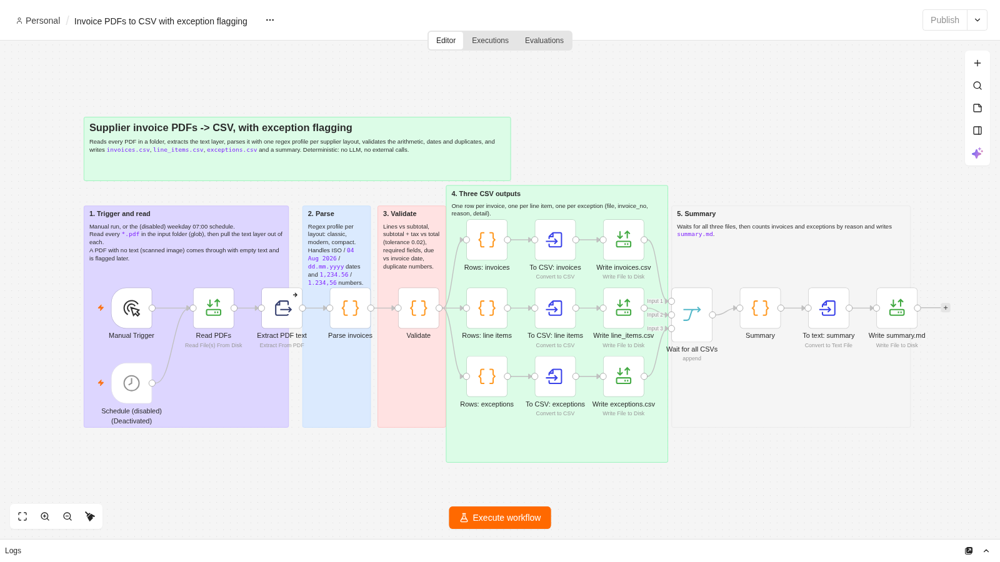
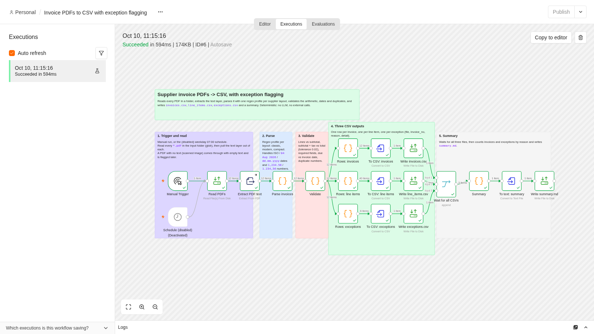
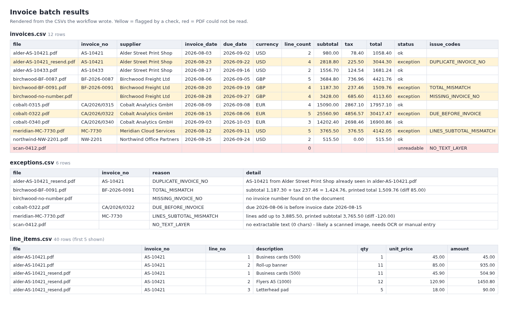

# Supplier invoice PDFs to CSV, with exception flagging (n8n)

## 60-second write-up

**Problem.** Finance and ops teams get supplier invoices as PDFs from many suppliers, each with its own layout.
Someone retypes them into a spreadsheet, and the bad ones (wrong totals, missing numbers, duplicates,
impossible dates, scans) are found late, or after the payment run.

**What it does.** An n8n workflow reads every PDF in a folder, extracts the text layer, parses it with one regex
profile per supplier layout (3 layouts here), then validates each invoice: line items vs subtotal, subtotal + tax vs
total (0.02 tolerance), required fields, due date vs invoice date, and duplicate invoice numbers. It writes three
CSVs (`invoices.csv` one row per invoice, `line_items.csv` one row per line, `exceptions.csv` one row per problem with
file, invoice number, reason code and a human-readable detail) plus a `summary.md`. Fully deterministic: no LLM, no
external calls, so the same PDFs always give the same CSVs.

**Result (real run, execution #6, 594 ms).** 12 PDFs from 5 fictional suppliers in 3 layouts: 11 parsed into
structured data (40 line items), 6 passed every check, **6 flagged**: 1 duplicate invoice number, 1 total that does not
match subtotal + tax (off by 85.00), 1 missing invoice number, 1 due date before the invoice date, 1 printed subtotal
that does not match its lines (off by 120.00), 1 scanned image PDF with no text layer (needs OCR or manual entry).
All 12 files match the ground truth in `sample-data/expected.json` (`tools/verify.py`: 12/12).





## Layout of this folder

| Path | What |
|---|---|
| `workflow.json` | Workflow exported from the live n8n after the successful run (no credentials needed) |
| `sample-data/` | 12 synthetic PDFs + `expected.json` (ground truth for each file) |
| `output/` | Real run output: `invoices.csv`, `line_items.csv`, `exceptions.csv`, `summary.md`, `results.html` (CSVs rendered as tables) |
| `screenshots/` | Canvas, execution view, results table |
| `tools/` | PDF generator, workflow builder, Code-node sources (`tools/code/*.js`), REST runner, verifier, screenshot and export scripts |
| `RUN-EVIDENCE.md` | Execution id, timestamps, per-node counts, verification output |

## How to run it

n8n 2.x restricts file nodes to `~/.n8n-files`, so inputs and outputs live there.

```bash
# 1. (optional) regenerate the PDFs - fixed seed, byte-for-byte reproducible, Python stdlib only
python3 tools/generate_invoices.py sample-data

# 2. put the PDFs where n8n may read them
docker exec n8n mkdir -p /home/node/.n8n-files/invoice-pdf-to-csv/in /home/node/.n8n-files/invoice-pdf-to-csv/out
for f in sample-data/*.pdf; do docker cp "$f" n8n:/home/node/.n8n-files/invoice-pdf-to-csv/in/; done

# 3. import the workflow and run it (UI: open it and press "Execute workflow")
docker cp workflow.json n8n:/tmp/wf.json && docker exec n8n n8n import:workflow --input=/tmp/wf.json
# Note: `n8n execute` inside the running container clashes with the Code-node task broker port,
# so trigger the run from the UI or via the REST API (tools/n8n_run.py does it, as the UI does).

# 4. fetch the results
for f in invoices.csv line_items.csv exceptions.csv summary.md; do
  docker cp n8n:/home/node/.n8n-files/invoice-pdf-to-csv/out/$f output/$f; done
python3 tools/verify.py          # compares against sample-data/expected.json
python3 tools/render_results.py  # output/results.html
```

To use it on real PDFs: drop them into the `in/` folder. A new supplier layout means adding one profile object
(labels, date format, number format, line-item regex) at the top of the `Parse invoices` Code node; nothing else changes.

## Nodes (25 incl. 6 sticky notes)

| Node | Type | Purpose |
|---|---|---|
| Manual Trigger | manualTrigger | Run on demand |
| Schedule (disabled) | scheduleTrigger | Optional weekday 07:00 run; shipped disabled |
| Read PDFs | readWriteFile (read) | Glob `in/*.pdf`, one item per file |
| Extract PDF text | extractFromFile (pdf) | Text layer per PDF; error output continues so one bad file does not stop the batch |
| Parse invoices | code | Regex profile per layout (`classic`, `modern`, `compact`): header fields, line items, totals; normalises dates to ISO and numbers (`1,234.56` / `1.234,56`) |
| Validate | code | The checks listed above, each with a reason code and a readable detail |
| Rows: invoices / line items / exceptions | code (x3) | Flatten to one row per invoice / line / problem |
| To CSV (x3) | convertToFile | Build the CSV binaries |
| Write invoices.csv / line_items.csv / exceptions.csv | readWriteFile (write) | Write to `out/` |
| Wait for all CSVs | merge | Joins the three branches |
| Summary | code | Counts, exceptions by reason, clean totals per currency |
| To text: summary / Write summary.md | convertToFile / readWriteFile | `summary.md` |

Reason codes: `NO_TEXT_LAYER`, `UNKNOWN_LAYOUT`, `PDF_READ_ERROR`, `MISSING_INVOICE_NO`, `MISSING_FIELD`,
`LINE_AMOUNT_MISMATCH`, `LINES_SUBTOTAL_MISMATCH`, `TOTAL_MISMATCH`, `DUE_BEFORE_INVOICE`, `DUPLICATE_INVOICE_NO`.
Duplicates are judged per supplier + invoice number, and the later file (file-name order) is the one flagged.

## What is mocked, and known limits

- Nothing external is mocked: there is no Slack/email step. The "alert" is the `exceptions.csv` file.
- The input PDFs are synthetic (generated), so layouts are clean; real supplier PDFs will need profile tuning, and
  the scanned-image case is only detected and flagged, not OCR'd (OCR would be a separate add-on).
- Convert to File writes CSVs with a UTF-8 BOM (opens correctly in Excel); strip it if a downstream tool objects.
- If a branch has zero rows (e.g. no exceptions in a batch), its CSV is not rewritten, so clear old output first when
  re-running on a different batch.

## Cost per run

Measured: **$0 metered** (no paid API, no LLM, no network calls from the workflow; ran in 594 ms on a self-hosted
n8n). Hosting cost is whatever the server already costs.

## Licences

| Component | Licence | Used for |
|---|---|---|
| n8n 2.42.6 (self-hosted) | Sustainable Use License (source-available, not OSI-approved) | Workflow engine |
| Python 3.13 standard library | PSF License | PDF generator, runner, verifier (no third-party Python packages) |
| puppeteer-core 25.12.0 | Apache-2.0 | Screenshots only (not part of the workflow) |
| Google Chrome (headless) | Proprietary freeware | Screenshots only |

## Synthetic data, no client work

All invoices, suppliers (Alder Street Print Shop, Birchwood Freight Ltd, Cobalt Analytics GmbH, Meridian Cloud
Services, Northwind Office Partners), addresses and amounts are invented. Nothing here comes from a client or employer.
